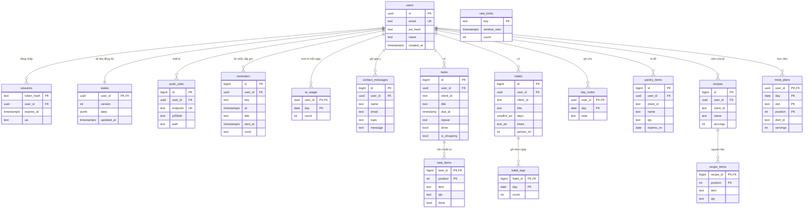

# Lược đồ cơ sở dữ liệu (mục 3a)

PostgreSQL trên Supabase, schema `remi`. Migration ở `db/migrations/` chạy theo thứ tự tên (`npm run db:migrate`), chạy lại nhiều lần không lỗi.

| Migration | Nội dung |
|---|---|
| `001_init.sql` | Tài khoản, phiên, tài liệu trạng thái, thiết bị nhận thông báo, lời nhắc, lượt AI, giới hạn tần suất |
| `002_app.sql` | Tên người dùng, thông tin thiết bị, điều kiện nhắc, hàm dọn dữ liệu cũ |
| `003_contact.sql` | Lời nhắn từ trang Liên hệ |
| `004_tach_bang.sql` | Tách dữ liệu ứng dụng thành bảng riêng: việc, thói quen, ghi chú ngày, tủ đồ, món, thực đơn |

## ERD



## Vì sao vẫn giữ `states.data`

App chạy được khi mất mạng và đồng bộ nhiều thiết bị: mỗi máy giữ một bản, khi có mạng thì gộp theo từng mục rồi ghi lên kèm số phiên bản (khoá lạc quan, `409` nếu lệch). Cách này cần một tài liệu duy nhất cho mỗi người.

Để dữ liệu vẫn có **bảng và quan hệ rõ ràng**, migration 004 thêm trigger `states_sync`. Mỗi lần `states.data` được ghi, hàm `remi.sync_state` tách tài liệu ra các bảng ở trên **trong cùng giao dịch**:

- Giá trị hỏng từ trình duyệt (ngày sai, giờ sai, số sai) thành `null` hoặc giá trị mặc định, không làm lỗi lần lưu.
- Nếu việc tách bảng vẫn lỗi vì lý do khác, trigger ghi cảnh báo và **giữ nguyên lần lưu** của người dùng.
- `client_id` là id do app tạo, duy nhất trong phạm vi một người (`unique (user_id, client_id)`).
- Xoá tài khoản thì mọi bảng con bị xoá theo (`on delete cascade`).

Ví dụ truy vấn trên bảng đã tách:

```sql
-- Đồ trong tủ sắp hết hạn trong 3 ngày
select name, qty, expires_on from remi.pantry_items
where user_id = $1 and expires_on <= current_date + 3 order by expires_on;

-- Số ngày đạt mục tiêu uống nước trong 30 ngày
select count(*) from remi.habit_logs l join remi.habits h on h.id = l.habit_id
where h.user_id = $1 and h.portion_ml is not null
  and l.day >= current_date - 30 and l.count >= cardinality(h.times);
```

## Bảo mật

- Mọi bảng bật **Row Level Security** và không có policy, thu hồi quyền của `anon`, `authenticated`: không đọc được qua API tự sinh của Supabase. Chỉ máy chủ (kết nối Postgres trực tiếp) mới truy cập. `db/verify-rls.sql` kiểm tra điều này trong CI.
- Truy vấn trong `lib/repo.js` đều tham số hoá (postgres.js tagged template).

## Kiểm thử

| File | Kiểm gì |
|---|---|
| `db/verify-rls.sql` | Mọi bảng đã bật RLS |
| `db/smoke.sql` | Email không trùng hoa thường, khoá lạc quan, lời nhắc đổi giờ |
| `db/test-tach-bang.sql` | Tách đúng việc, món cần mua, thói quen, nhật ký, ghi chú, tủ đồ, món, thực đơn; bỏ dữ liệu hỏng; cập nhật làm mới bảng; dữ liệu mỗi người tách biệt; xoá tài khoản xoá theo; anon không đọc được |

CI dựng PostgreSQL 16, chạy tất cả migration, các file kiểm tra, rồi chạy lại migration để chắc chắn chạy lặp không lỗi.

## Rà soát lược đồ

| Ngày | Người rà soát | Nhận xét | Đã sửa |
|---|---|---|---|
| | | | |
