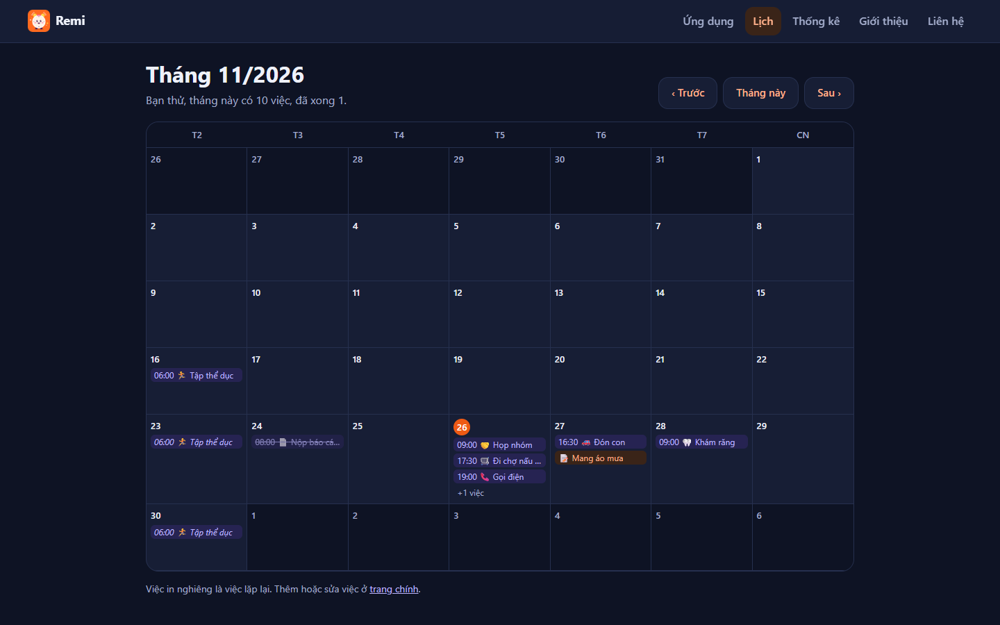
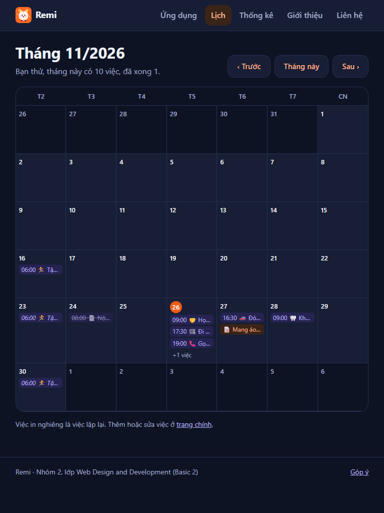
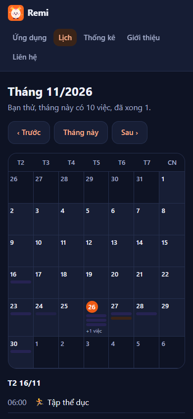
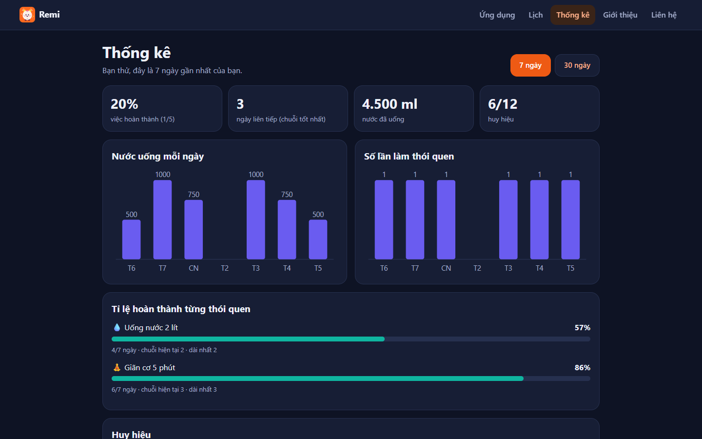
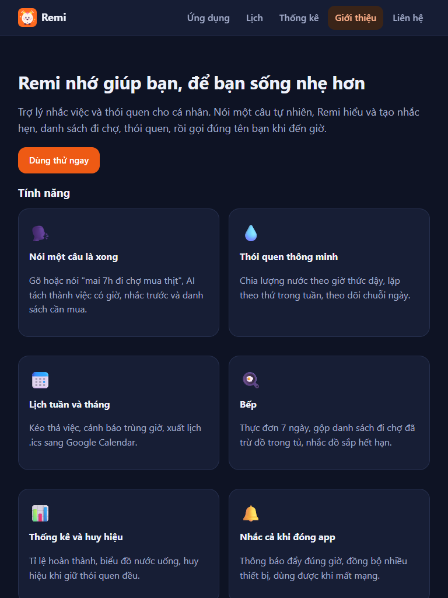

# Tailwind CSS (mục 2b, việc T5)

Bốn trang Next.js (`/lich`, `/thong-ke`, `/gioi-thieu`, `/lien-he`) dựng bố cục bằng utility class của Tailwind CSS 3.
Ứng dụng chính ở `/` (`web/`, trang tĩnh) vẫn dùng CSS riêng trong `web/css/`.

## Các tệp

| Tệp | Vai trò |
|---|---|
| `tailwind.config.js` | Quét `app/**`, hai mốc màn hình, bảng màu trỏ tới biến CSS |
| `postcss.config.js` | Bật Tailwind và Autoprefixer khi `next build` |
| `app/trang.css` | `@tailwind base/components/utilities`, biến màu sáng và tối, kiểu nền cho thẻ HTML |
| `app/_components/ui.js` | Chuỗi class dùng lặp lại (thẻ, nút, tiêu đề, lưới hai cột) |

Không dùng CDN: CSS được biên dịch lúc build nên CSP trong `lib/csp.js` giữ nguyên.

## Quy ước

- **Màn hình:** viết cho màn từ 641px trước. `max-sm:` là điện thoại (≤640px), `wide:` là từ 860px.
- **Màu:** dùng `bg-surface`, `text-muted`, `border-line`, `bg-accent-soft`... Màu đổi theo chế độ tối qua biến CSS nên không cần `dark:`. Vì màu là biến CSS, cú pháp độ mờ kiểu `bg-surface/50` không chạy; cần thì dùng `color-mix` (xem thanh trên trong `Site.js`).
- **Tên class viết đủ**, không ghép kiểu `` `text-${mau}` ``, nếu không Tailwind không sinh CSS.
- Lớp `form-status`, `ok`, `bad` giữ trong `@layer components` vì `web/js/lien-he.js` gán lại `className`.

## Ví dụ

```jsx
// lịch tháng 7 cột, ô thấp hơn trên điện thoại
<div className="grid grid-cols-7" role="row">
  <div className="min-h-24 border-b border-r border-line p-1.5 max-sm:min-h-16 max-sm:p-1">

// 2 ô số liệu mỗi hàng, 4 ô khi đủ rộng
<div className="mb-4 grid grid-cols-2 gap-3 wide:grid-cols-4">
```

## Bằng chứng

Ảnh chụp bản build production, dùng dữ liệu mẫu.

| Máy tính 1440px | Tablet 768px | Điện thoại 390px |
|---|---|---|
|  |  |  |
|  |  |  |

Kiểm tra ngày 26/11/2026:

- `npm test`: 190/190 đạt, gồm `lib/test/tailwind.test.js` (biên dịch thật CSS rồi kiểm utility, mốc màn hình, màu).
- `npm run test:responsive`, `test:e2e`, `test:features`, `test:kitchen`: đều đạt (chạy bằng Microsoft Edge qua `CHROME_PATH`). Các bộ này kiểm ứng dụng chính ở `/`.
- Bốn trang Next.js: so ảnh trước và sau khi chuyển ở 320, 390, 768, 1440px, sáng và tối; không tràn ngang, không lỗi trang, bố cục khớp.

## Lỗi đã sửa cùng lúc

`/gioi-thieu` và `/lien-he` trắng trang ở bản production: hai trang dựng tĩnh lúc build nên script không có nonce, bị CSP của `middleware.js` chặn. Cả hai giờ đặt `export const dynamic = 'force-dynamic'`, và có test chặn lỗi này quay lại.
