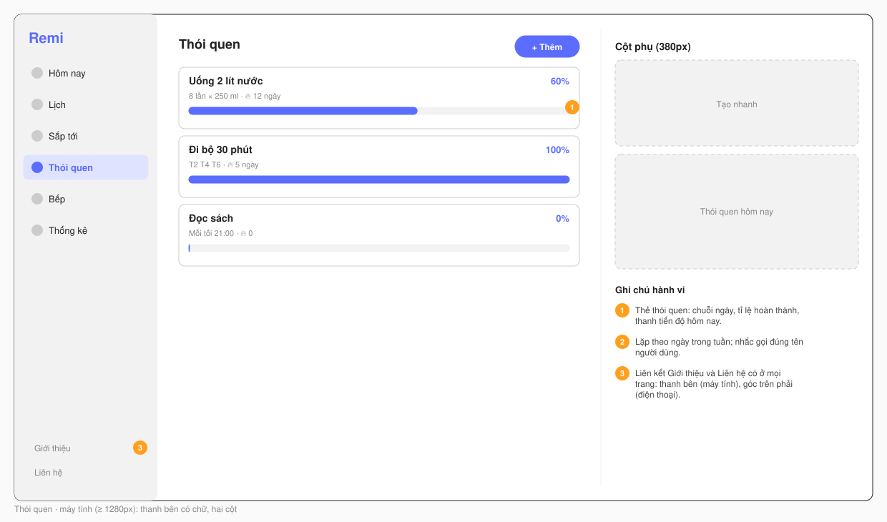
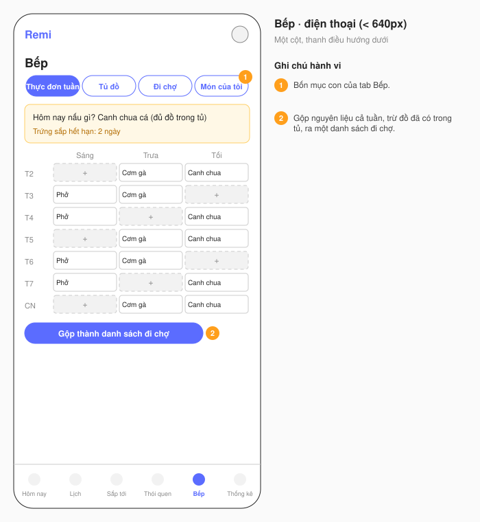
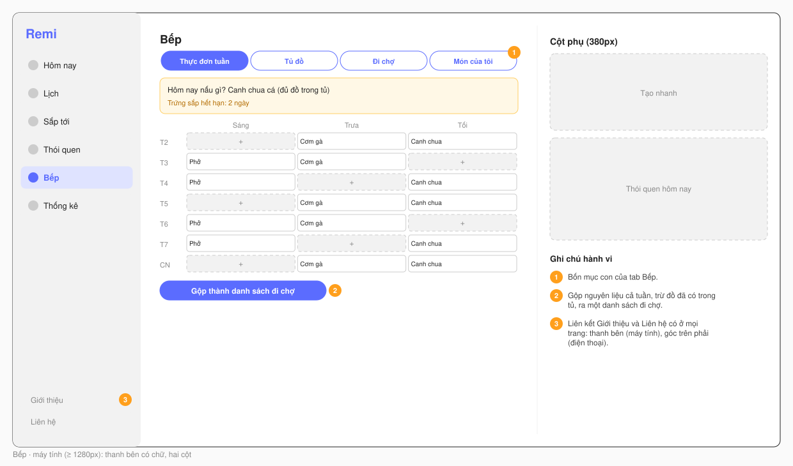
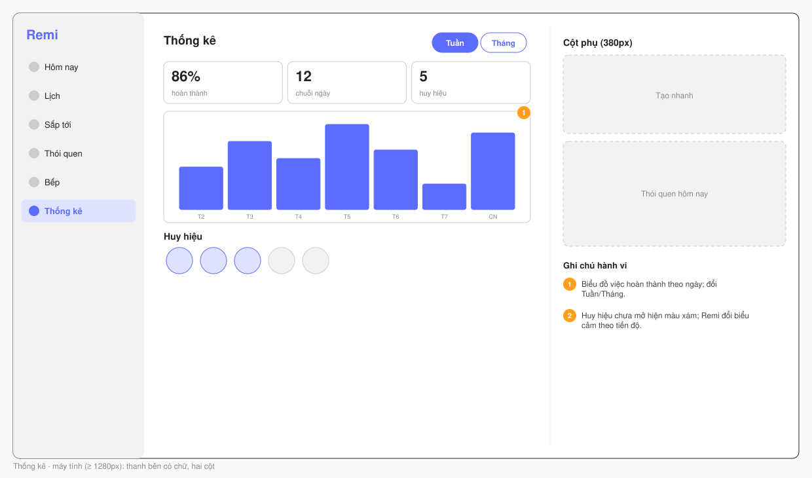

# Wireframe Remi

Wireframe low-fi cho 5 màn chính, mỗi màn có 2 bản: **điện thoại** (dưới 640px, thanh điều hướng dưới) và **máy tính** (từ 1280px, thanh bên + cột phụ). Bản máy tính bảng nằm giữa hai bản này, xem bảng bố cục trong README gốc.

Số màu cam trên hình ứng với *Ghi chú hành vi* bên cạnh.

| Màn | Điện thoại | Máy tính | Đường dẫn trong app |
|---|---|---|---|
| Hôm nay |  |  | `/` |
| Lịch |  |  | `/lich` (trang Next.js) và `/?tab=cal` |
| Thói quen |  |  | `/?tab=habits` |
| Bếp |  |  | `/?tab=kitchen` |
| Thống kê |  |  | `/thong-ke` (trang Next.js) và `/?tab=stats` |

## Công cụ vẽ

Wireframe vẽ bằng mã: script Python `make_wireframes.py` sinh ra file SVG, không dùng Figma hay Adobe XD. Ưu điểm: sửa được qua PR như mã nguồn, xem lịch sử thay đổi trên GitHub. File gốc chính là script này.

## Sửa wireframe

Nội dung nằm trong `make_wireframes.py`, mỗi màn là một hàm. Sửa xong thì chạy:

```bash
python3 docs/wireframes/make_wireframes.py
```


## Lịch sử duyệt

Nhóm duyệt wireframe trên issue [#22](https://github.com/Kaiser-2504/Project_Remi/issues/22): mỗi thành viên comment góp ý cho màn mình phụ trách. Người tổng hợp (Nguyễn Quang Thông) chép kết quả vào bảng dưới, kèm link comment.

Ngày duyệt: 26/11/2026. Kết quả: 5/5 màn đã duyệt, Lịch cần bổ sung khung xem tháng.

| Màn | Người góp ý | Góp ý | Xử lý | Link comment |
|---|---|---|---|---|
| Hôm nay | @spector-255006 | Thêm trạng thái "Chưa có việc nào sắp tới" khi danh sách trống | Chốt; app đã có dòng này, bổ sung vào wireframe sau | [comment](https://github.com/Kaiser-2504/Project_Remi/issues/22#issuecomment-7184052948) |
| Lịch | @vubui240932-cell | Wireframe vẽ xem tuần, app mặc định xem tháng | Chốt có điều kiện: bổ sung khung xem tháng vào wireframe | [comment](https://github.com/Kaiser-2504/Project_Remi/issues/22#issuecomment-7183812691) |
| Thói quen | @quangthong3005-ai | Vẽ thêm trạng thái chưa có thói quen nào | Chốt | [comment](https://github.com/Kaiser-2504/Project_Remi/issues/22#issuecomment-7183827316) |
| Bếp | @Kaiser-2504 | Bản điện thoại nên vẽ rõ 4 mục con cuộn ngang | Chốt | [comment](https://github.com/Kaiser-2504/Project_Remi/issues/22#issuecomment-7183604817) |
| Thống kê | @tuyettran240929-cell | Ghi chú thêm trang `/thong-ke` (Next.js đọc CSDL) | Chốt; đã ghi ở bảng Khác biệt bên dưới | [comment](https://github.com/Kaiser-2504/Project_Remi/issues/22#issuecomment-7183799274) |

## Khác biệt giữa wireframe và app hiện tại

| Màn | Wireframe | App hiện tại |
|---|---|---|
| Lịch | Xem theo tuần, có nút Tuần/Ngày | Có thêm chế độ Tháng (mặc định), và trang Next.js `/lich` hiển thị tháng |
| Thói quen, Bếp | Route dự kiến `/thoi-quen`, `/bep` | Là tab trong trang chính, mở thẳng bằng `/?tab=habits`, `/?tab=kitchen` |
| Thống kê | Một màn trong app | Có thêm trang Next.js `/thong-ke` đọc từ CSDL |
