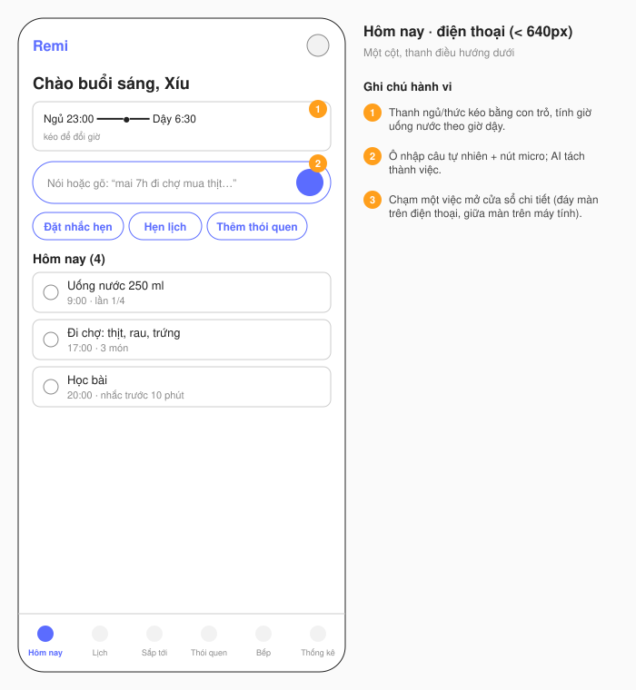
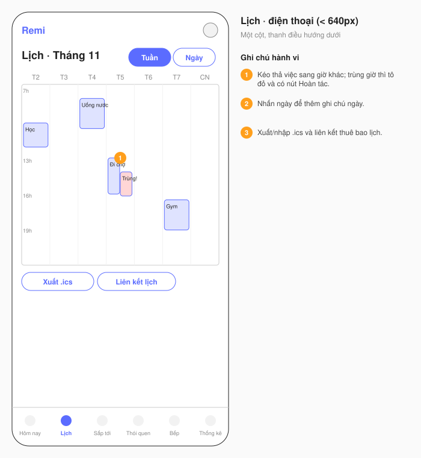
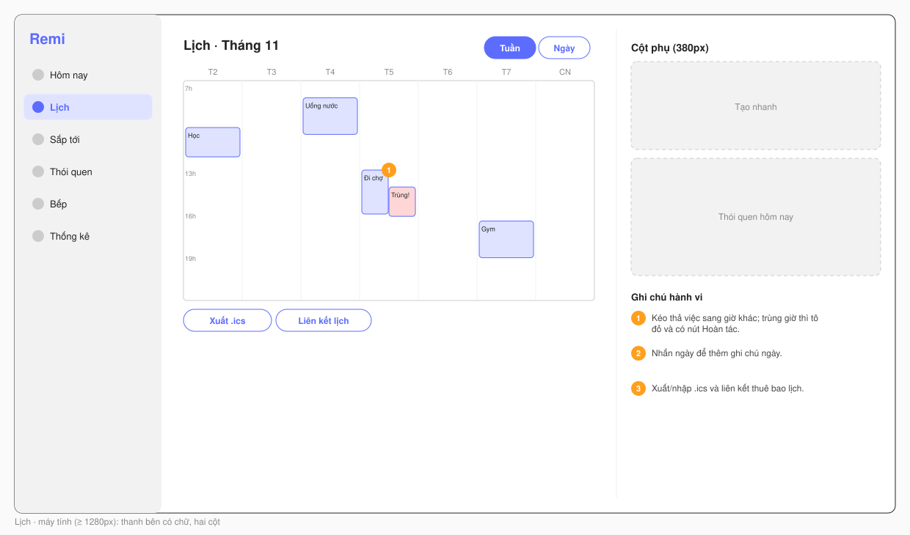
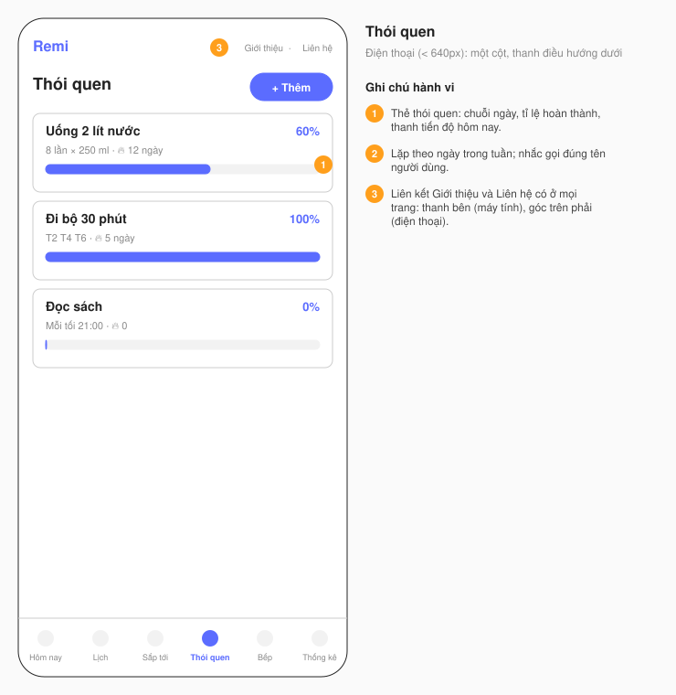
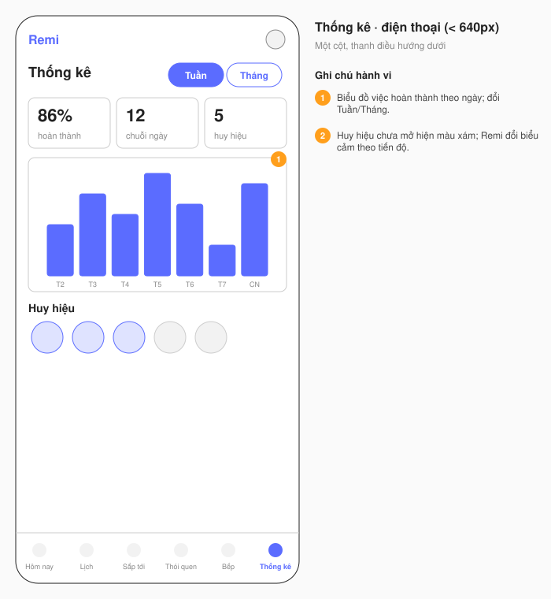

# Wireframe Remi

Wireframe low-fi cho 5 màn chính, mỗi màn có 2 bản: **điện thoại** (dưới 640px, thanh điều hướng dưới) và **máy tính** (từ 1280px, thanh bên + cột phụ). Bản máy tính bảng nằm giữa hai bản này, xem bảng bố cục trong README gốc.

Số màu cam trên hình ứng với *Ghi chú hành vi* bên cạnh.

| Màn | Điện thoại | Máy tính | Route dự kiến |
|---|---|---|---|
| Hôm nay |  |  | `/` |
| Lịch |  |  | `/lich` |
| Thói quen |  |  | `/thoi-quen` |
| Bếp |  |  | `/bep` |
| Thống kê |  |  | `/thong-ke` |

## Sửa wireframe

Nội dung nằm trong `make_wireframes.py`, mỗi màn là một hàm. Sửa xong thì chạy:

```bash
python3 docs/wireframes/make_wireframes.py
```

Nếu nhóm vẽ lại bằng Figma, dán link vào đây: **Figma:** _(chưa có)_

## Lịch sử duyệt

| Ngày | Ai duyệt | Kết quả / thay đổi | Biên bản |
|---|---|---|---|
| | | | [buổi họp](../team/bien-ban/) |
